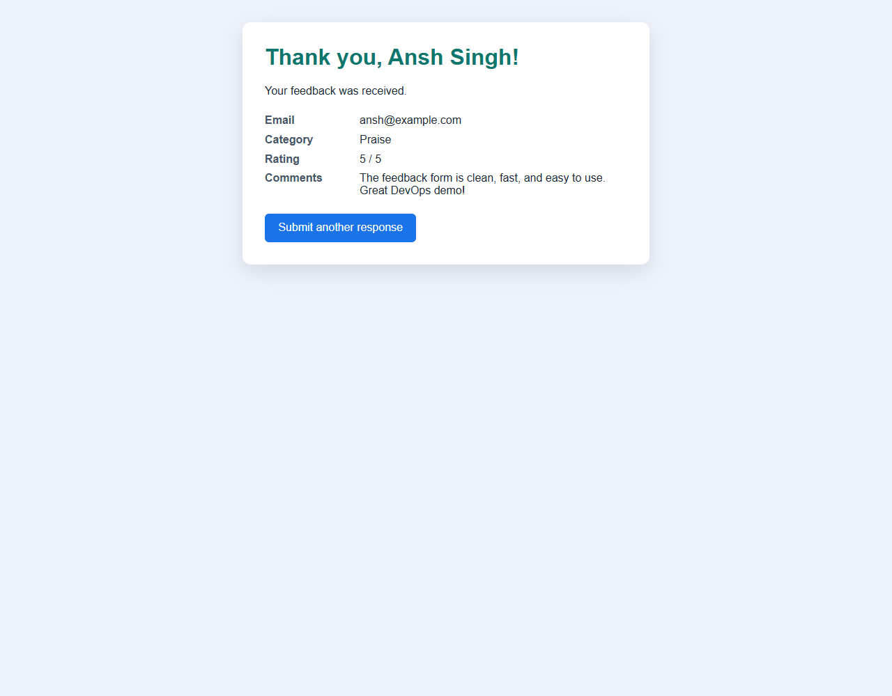
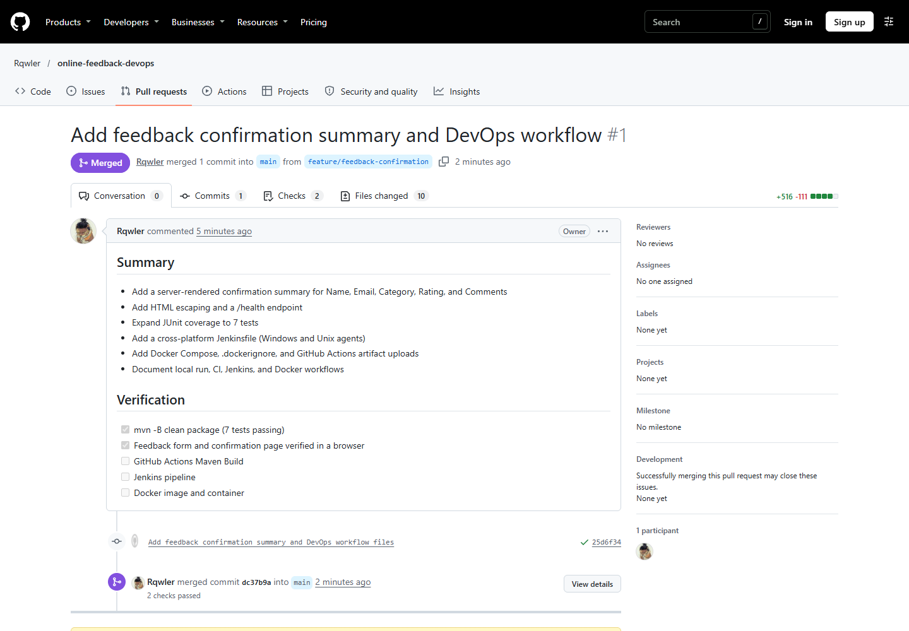
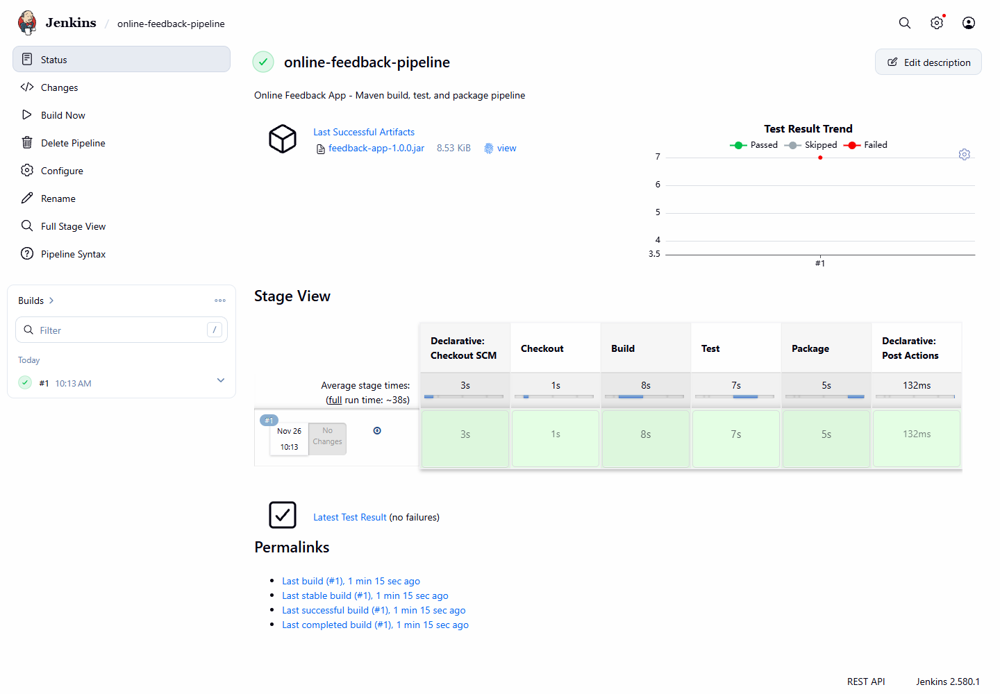
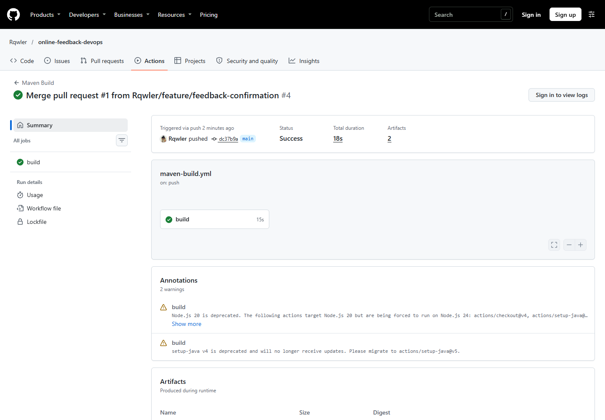
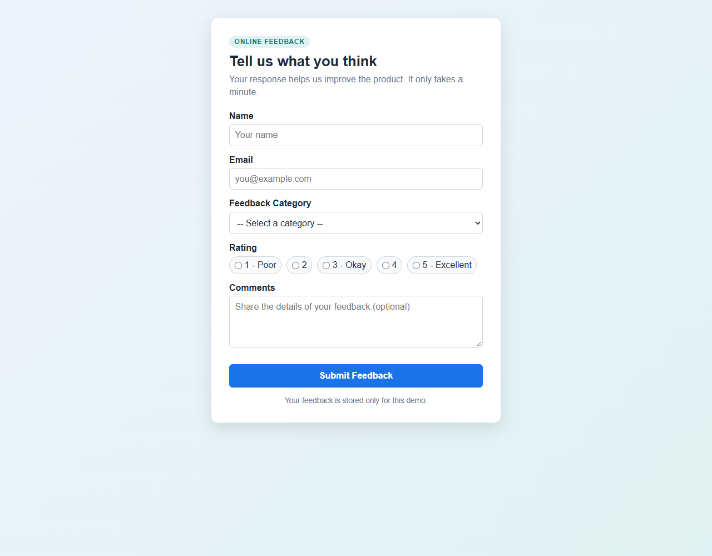
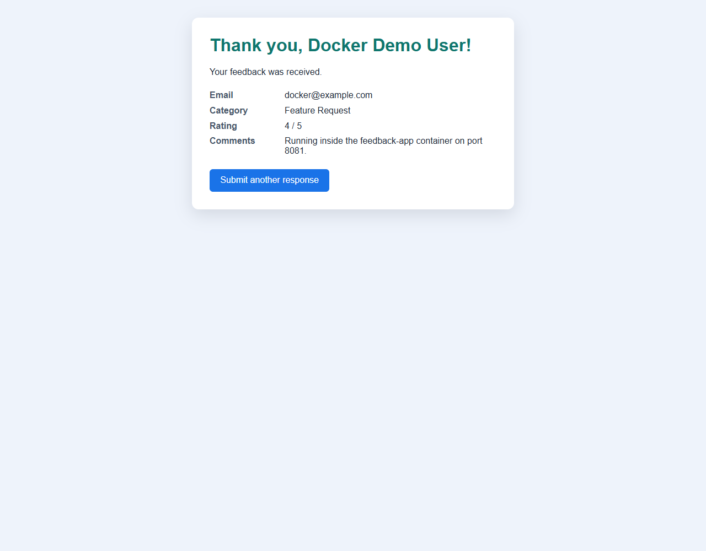

# Checkpoint Evidence

Captured on 2026-11-26 for the Online Feedback App DevOps workflow.

| Item | Value |
| --- | --- |
| Repository | <https://github.com/Rqwler/online-feedback-devops> |
| Feature branch | `feature/feedback-confirmation` |
| Feature commit | `25d6f34` |
| Pull request | [#1](https://github.com/Rqwler/online-feedback-devops/pull/1) - merged |
| Merge commit | `dc37b9a` |
| Jenkins build | `online-feedback-pipeline #1` - SUCCESS |
| GitHub Actions | Feature push, pull request, and `main` merge runs - all successful |
| Docker image | `feedback-app:1.0` |
| Docker container | `feedback-app`, host port `8081` -> container port `8080` |

## 1. Feedback form in a browser

The form contains Name, Email, Feedback Category, Rating, Comments, and a Submit button.


Server-side confirmation after submitting the form:



## 2. Successful Maven build and artifact

Command:

```powershell
mvn -B clean package
```

Key output:

```text
[INFO] Tests run: 7, Failures: 0, Errors: 0, Skipped: 0
[INFO] Building jar: ...\target\feedback-app-1.0.0.jar
[INFO] BUILD SUCCESS
```

Artifact details are in `evidence/maven-artifact.txt`:

```text
Artifact: target/feedback-app-1.0.0.jar
Size: 8715 bytes
SHA256: 828F88B8BB141A560D4A18F9A558D68660B15610803133161531C90FE8E9EFE8
```

Full build log: [`evidence/maven-build.log`](evidence/maven-build.log)

## 3. GitHub feature branch, commit, pull request, and merge

Commands:

```powershell
git switch -c feature/feedback-confirmation
git add .
git commit -m "Add feedback confirmation summary and DevOps workflow files"
git push -u origin feature/feedback-confirmation
gh pr create --base main --head feature/feedback-confirmation
gh pr merge 1 --merge
```

Evidence:

- Branch and commit history: [`evidence/github-branch.png`](evidence/github-branch.png)
- Open pull request: [`evidence/github-pr.png`](evidence/github-pr.png)
- Merged pull request: [`evidence/github-pr-merged.png`](evidence/github-pr-merged.png)
- Merge details: [`evidence/github-pr.txt`](evidence/github-pr.txt)



## 4. Jenkins pipeline success

Jenkins job `online-feedback-pipeline` uses **Pipeline script from SCM** with the repository URL, branch `*/main`, and script path `Jenkinsfile`.

Build result:

```text
online-feedback-pipeline #1
Result: SUCCESS
Duration: 38 seconds
Revision: dc37b9a7b6fb87a1d5f7630d571e70a6ed8b7e14
Artifact: feedback-app-1.0.0.jar (8.53 KiB)
Tests: 7 passed, 0 failed
```

Evidence:

- Job and stage view: [`evidence/jenkins-success.png`](evidence/jenkins-success.png)
- Build details: [`evidence/jenkins-stages.png`](evidence/jenkins-stages.png)
- Console output: [`evidence/jenkins-console.png`](evidence/jenkins-console.png), [`evidence/jenkins-console.log`](evidence/jenkins-console.log)
- Build metadata: [`evidence/jenkins-build.json`](evidence/jenkins-build.json)



## 5. GitHub Actions success

Workflow: `.github/workflows/maven-build.yml`

The workflow runs on every push, on pull requests to `main`, and on manual dispatch. It runs `mvn -B clean verify` and uploads the JAR and Surefire reports.

Runs:

| Run | Branch | Event | Result | URL |
| --- | --- | --- | --- | --- |
| #45756740790 | `feature/feedback-confirmation` | push | success | <https://github.com/Rqwler/online-feedback-devops/actions/runs/45756740790> |
| #45756760003 | `feature/feedback-confirmation` | pull_request | success | <https://github.com/Rqwler/online-feedback-devops/actions/runs/45756760003> |
| #45756981382 | `main` | push | success | <https://github.com/Rqwler/online-feedback-devops/actions/runs/45756981382> |

Evidence:

- Feature push run: [`evidence/github-actions-success.png`](evidence/github-actions-success.png)
- `main` merge run: [`evidence/github-actions-main-success.png`](evidence/github-actions-main-success.png)
- Run list: [`evidence/github-actions.txt`](evidence/github-actions.txt)



## 6. Docker image, container, and browser result

Commands:

```powershell
docker build -t feedback-app:1.0 .
docker run -d --name feedback-app -p 8081:8080 feedback-app:1.0
docker ps
curl http://localhost:8081/health
```

Terminal output:

```text
REPOSITORY     TAG   IMAGE ID       SIZE
feedback-app   1.0   56ada5166904   450MB

NAMES          IMAGE              STATUS         PORTS
feedback-app   feedback-app:1.0   Up             0.0.0.0:8081->8080/tcp, [::]:8081->8080/tcp

HEALTH STATUS=200 BODY={"status":"UP"}
FORM STATUS=200 LENGTH=4380
```

The container serves the same form in the browser:



Docker confirmation page:



Evidence:

- Build log: [`evidence/docker-build.log`](evidence/docker-build.log)
- Image list: [`evidence/docker-images.txt`](evidence/docker-images.txt)
- Running container: [`evidence/docker-ps.txt`](evidence/docker-ps.txt)
- Health and form checks: [`evidence/docker-health.txt`](evidence/docker-health.txt)
- Container logs: [`evidence/docker-logs.txt`](evidence/docker-logs.txt)
- Container ID: [`evidence/docker-run.txt`](evidence/docker-run.txt)
